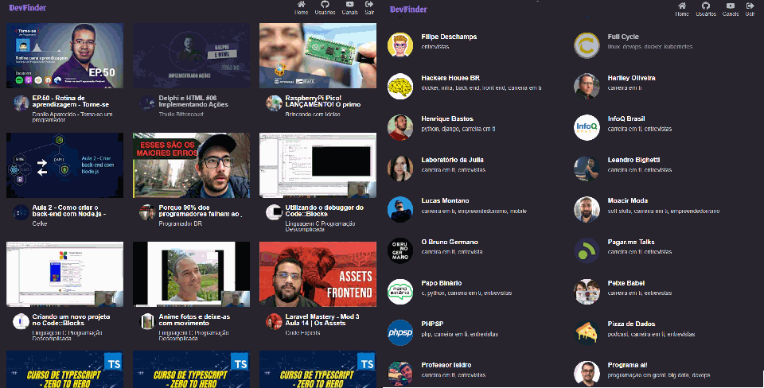

# DevFinder

<div align="center">
    
</div>

<br />
<strong>Vídeos, devs e canais sobre Tecnologia, Desenvolvimento e Programação em Português, reunidos em um só lugar.</strong>

## Sobre

- **Vídeos**: conteúdo sobre tecnologia, desenvolvimento e programação em português, reunido em um feed único.
- **Usuários GitHub**: perfis de desenvolvedores da comunidade, para descobrir e acompanhar.
- **Canais**: canais de tecnologia organizados por tema — filtro por categoria, não só uma lista solta. Temas incluem Desenvolvimento Back-End, Desenvolvimento Front-End, Desenvolvimento Mobile Nativo & Híbrido, Banco de Dados & Bancos Não Relacionais, Infraestrutura, Linux, Segurança, Inteligência Artificial, Lógica de Programação, Games, e Entrevista/Webinars & Dicas.
- **Busca unificada**: encontre vídeo ou canal direto pela barra de busca, sem precisar navegar por menus.

## Stack

| Camada | Tecnologias |
|---|---|
| Framework | Next.js 15 (App Router) + TypeScript |
| Estilização | Tailwind CSS v4 (config CSS-first, sem `tailwind.config.ts`) |
| Estado | Redux Toolkit — slices segmentados por domínio |
| Autenticação | OAuth GitHub, backend próprio (`devfinder-api`) |
| Data fetching | `fetch` nativo (Server Components, SSR/ISR) + Axios (Client Components) |
| Testes | Jest, Testing Library |

## Demostração

Caso deseje visualizar aplicação antes de instalar, você pode acessar o <a href="https://devfinder.vercel.app/">link da aplicação</a> que esta hospedada na Vercel.

# Para executar locamente:

#### 1.Pré-requisitos

Antes de começar, você vai precisar ter instalado em sua máquina as seguintes ferramentas:
[Git](https://git-scm.com), [Node.js](https://nodejs.org/en/). 
Além disto é bom ter um editor para trabalhar com o código como [VSCode](https://code.visualstudio.com/)

#### 2.Instalação

Para a instalação do projeto, primeiramente baixe o <a href="https://nodejs.org/en/">Node.js</a>.

Após a instalação do Node, você deve clonar o repositório:
```bash
git clone https://github.com/MarceloVilela/devfinder-next.git
```
Após a clonagem, execute o comando abaixo dentro da pasta do projeto para baixar todas as dependências:
```bash
pnpm install
```

#### 3.Variáveis ambiente
Crie um arquivo .env, 
copie o conteúdo do arquivo .env.example e cole dentro de .env,
altere caso necessário.

Só `NEXT_PUBLIC_API_URL` é obrigatória; as demais são opcionais ou recomendadas (tabela em
[`CLAUDE.md`](./CLAUDE.md), seção "Variáveis de ambiente").

#### 4.Como utilizar

Após clonar, execute o comando abaixo:

```bash
pnpm dev
```

Abra [http://localhost:3000](http://localhost:3000) em seu navegador para utilizar a aplicação.

## Arquitetura de renderização

App Router. A regra é: **SSR/ISR só para dado público**, CSR para o que depende da sessão.

- **Página 1 das listagens** (`/`, `/video`, `/user`, `/channel`): Server Component com ISR de 8h
  (○ Static).
- **Detalhe** (`/user/:slug`, `/video/:slug`, `/channel/:slug`): renderizado por request, sem
  `generateStaticParams` porque o conjunto de slugs é aberto; tem `loading.tsx` enquanto o
  backend responde.
- **Página 2+ das listagens e telas de sessão** (favoritos, não seguidos, inscrições): Client
  Components que buscam via axios. A sessão vive num cookie `httpOnly` setado pelo backend e o
  axios (`withCredentials`) o envia sozinho.
- **Custo aceito**: `?page=N` não é um link direto para uma página da listagem pública.

O motivo: ler `cookies()` ou `searchParams` num Server Component força a rota inteira a renderização
dinâmica, e a home passaria a depender do backend (plano gratuito, com cold start) em toda visita.
Detalhes e histórico em [`CLAUDE.md`](./CLAUDE.md), seção "Regra de renderização".

## Limitações conhecidas

- **Backend de referência sem SLA (cold start)** — o backend de demonstração roda num plano
  gratuito do Render: depois de um período sem acesso a instância dorme e a primeira requisição
  leva ~30-60s. A home e as listagens são estáticas (ISR) e não dependem dele em uma visita comum;
  as páginas de detalhe mostram um esqueleto de carregamento enquanto ele acorda. Detalhes,
  timeouts e trade-offs em [`docs/limitacoes-conhecidas.md`](./docs/limitacoes-conhecidas.md).
- **Perda esporádica de CSS em runtime (resolvida)** — até a migração para Tailwind CSS v4
  (setembro/2026), um bug do `styled-components` podia perder regras de CSS durante streaming SSR
  ([styled-components#3924](https://github.com/styled-components/styled-components/issues/3924)).
  A troca do motor de CSS eliminou a causa; histórico em
  [`docs/decisions/0002-styling-stack.md`](./docs/decisions/0002-styling-stack.md).
